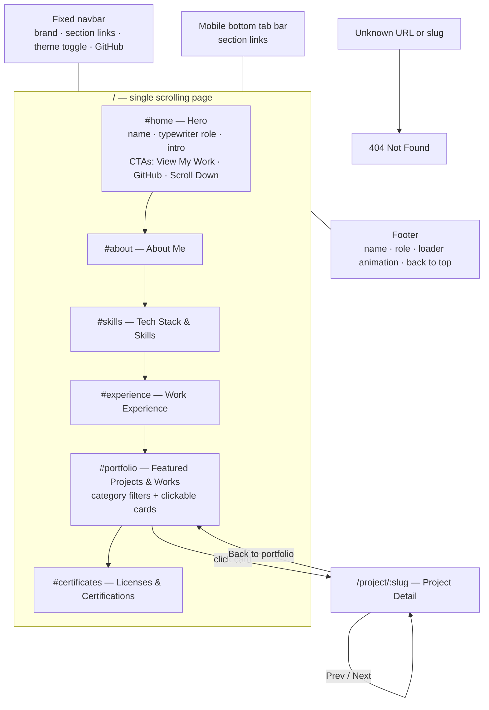
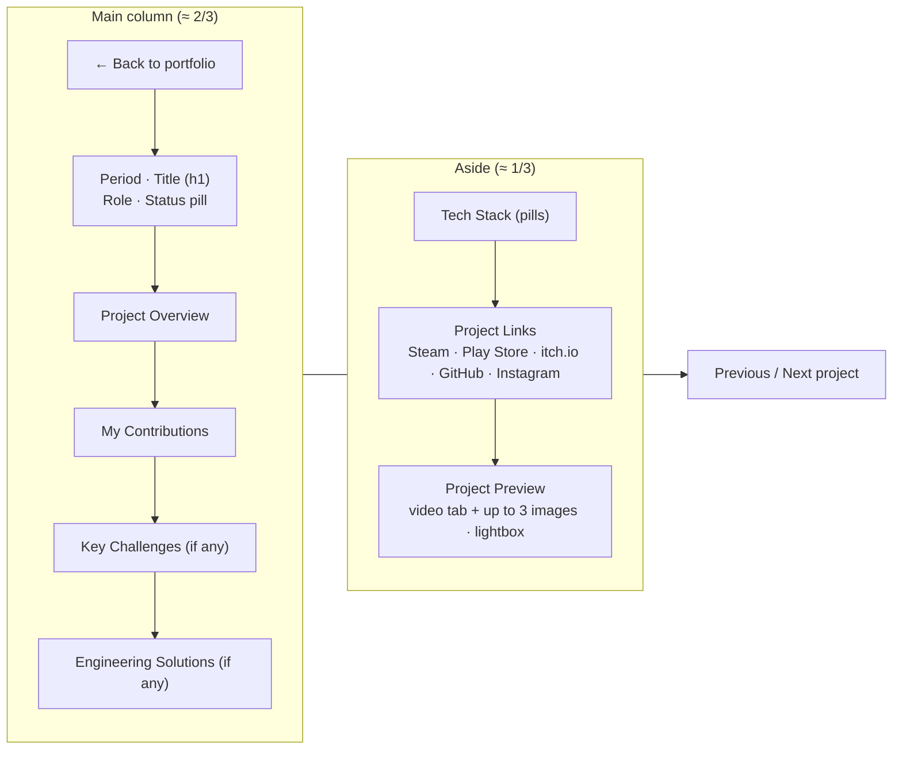

# PRD — Ea Portfolio v2

| | |
|---|---|
| **Owner** | Zibril Yuan Afrianto (ea) |
| **Status** | **Shipped (v2.0)**. This doc now describes the site as built. Remaining work is in §8 |
| **Last updated** | 2026-11-16 (rev. 3: synced with the code on `development` @ `418f5d8f`) |
| **Hosting** | Netlify (`https://ea-portfolio.netlify.app`) |
| **Reference** | https://www.widwickyy.net/ |

### Revision history

| Rev | Date | Change |
|---|---|---|
| 1 | 2026-10-20 | Initial draft: single-page scroll, experience, cosmic theme |
| 2 | 2026-10-20 | Added CV download (F4) and project detail pages (F5) |
| 3 | 2026-11-16 | Synced with the shipped site. **Palette changed** from cosmic blue to a monochrome (Notion/Linear-style) look. **CV download dropped.** **Category filters pulled forward** from v2.1. Detail page uses a two-column layout. Statuses and categories formalized |

---

## 1. Background

v1 was a multi-route Vue CLI app (Home / About / Portfolio / Certificate), with one dark/amber theme, no work history, and one short card per project.

v2 turns it into one scrolling story: *who I am → what I know → where I've worked → what I've built → proof*. Interviewers who want depth can open a dedicated page per project.

## 2. Goals

| # | Goal | Status |
|---|---|---|
| G1 | The whole portfolio is consumable by **scrolling alone** | ✅ Shipped |
| G2 | Show **professional work experience** | ✅ Shipped (4 roles) |
| G3 | **Dark & light themes** with a clean, high-legibility identity | ✅ Shipped as **monochrome**, not cosmic blue (see F3) |
| G4 | **Downloadable CV** | ⛔ Dropped for now (see F4) |
| G5 | **A dedicated page per project** showing engineering depth | ✅ Shipped. Challenges/solutions content still empty |
| G6 | Don't break existing links | ✅ Shipped (Netlify 301s + router redirects) |

### Non-goals
- Blog/articles (removed)
- A CMS or backend. Content stays as static data files in the repo.
- Contact form

## 3. Target users

| User | Need |
|---|---|
| **Recruiter / HR** | Quickly confirm role, experience and seniority, then find GitHub |
| **Studio lead / tech interviewer** | Read a project in depth: role, contributions, tech, links to builds and repos |
| **Peers / game-jam teammates** | Browse games and play demos |

---

## 4. Information architecture (as built)

### 4.1 Site map



### 4.2 Routes

| Path | Result |
|---|---|
| `/` | Home with sections `#home`, `#about`, `#skills`, `#experience`, `#portfolio`, `#certificates` |
| `/about`, `/portfolio`, `/certificate` | **301 →** `/#about`, `/#portfolio`, `/#certificates` (Netlify, plus a router-level redirect as a fallback) |
| `/project/:slug` | Project detail. 16 slugs, all pre-rendered |
| `/404`, anything else | 404 page |

---

## 5. Functional requirements

Status legend: ✅ shipped · 🟡 shipped with a gap · ⛔ dropped · ⏳ not started

### F1 — Single-page scroll navigation

| ID | Requirement | Status |
|---|---|---|
| F1.1 | All sections on `/`, each with a stable `id` | ✅ |
| F1.2 | Nav click smooth-scrolls to the section. The fixed navbar never covers the heading (`scroll-margin-top: var(--nav-h)`) | ✅ |
| F1.3 | URL hash updates while scrolling and on click. Opening `/#experience` lands on that section | ✅ |
| F1.4 | Scroll-spy highlights the active section on the desktop navbar and the mobile tab bar | ✅ |
| F1.5 | Legacy routes 301-redirect to their sections | ✅ |
| F1.6 | Respect `prefers-reduced-motion` (instant scroll, no reveal animations) | ✅ |
| F1.7 | Sections and cards fade in once when they enter the viewport | ✅ (`RevealOnScroll`, with a 1.2 s safety fallback so content never stays hidden) |
| F1.8 | Hero has **View My Work** (→ `#portfolio`), **GitHub**, and a **Scroll Down** cue (→ `#about`) | ✅ |
| F1.9 | From a project page, nav links go back to `/#<section>` | ✅ |
| F1.10 | Navbar gets a stronger background, border and blur after scrolling 20 px | ✅ |

### F2 — Work Experience section

| ID | Requirement | Status |
|---|---|---|
| F2.1 | Vertical timeline, newest first. The current job's dot is highlighted | ✅ |
| F2.2 | Each entry: period, role, company (linked), summary, highlight bullets, tech tags | ✅ |
| F2.3 | Content only from `src/content/experience.js` | ✅ |
| F2.4 | Optional `type` (Full-time / Contract / Internship / Freelance) and `location` | ✅ |
| F2.5 | Left-aligned timeline on mobile | ✅ |

**Schema** (`src/content/experience.js`)

```js
{
  id: 'bumi-studio',               // kebab-case, unique
  role: 'Game Programmer',
  company: 'Bumi Studio',
  companyUrl: 'https://…',         // optional
  type: 'Full-time',               // optional: Full-time | Contract | Internship | Freelance
  location: 'Kota Malang, Indonesia (On-site)', // optional
  start: '2025-10',                // ISO year-month
  end: null,                       // null = Present
  summary: 'One sentence.',
  highlights: ['…'],               // ≥ 2 (enforced by test)
  tags: ['C#', 'Unity Engine']     // ≥ 1 (enforced by test)
}
```

### F3 — Dark/light mode and visual identity

> **Decision change (rev. 3):** the cosmic blue palette from rev. 1 was replaced by a **monochrome palette** (warm off-white / near-black, inspired by Notion and Linear). The token *names* are unchanged, so the system design still applies.

| ID | Requirement | Status |
|---|---|---|
| F3.1 | Theme toggle (sun/moon) in the navbar on all viewports | ✅ |
| F3.2 | First visit follows the OS setting. A manual choice is saved in `localStorage` and wins | ✅ |
| F3.3 | No flash of the wrong theme (inline boot script in `index.html`) | ✅ |
| F3.4 | Class-based dark mode. Colors come from semantic tokens | 🟡 A few components still use raw Tailwind colors (see §8, K-07) |
| F3.5 | Both themes pass WCAG AA | 🟡 Light mode: muted text on `surface-hover` (4.30:1) and `tag` (4.18:1) is just under 4.5:1 (see K-06) |
| F3.6 | ~200 ms color transition only while toggling | ✅ |
| F3.7 | Favicon, `theme-color`, scrollbar and selection colors follow the theme | 🟡 `theme-color` still uses old cosmic hex values (K-05) |

**Palette (as built)**

| Token | Light | Dark |
|---|---|---|
| `--bg` | `#FBFBFA` | `#0A0A0A` |
| `--surface` | `#FFFFFF` | `#121212` |
| `--surface-hover` | `#F2F2F0` | `#1C1C1C` |
| `--border` | `#E6E5E3` | `#262626` |
| `--text` | `#2F2E2B` | `#F5F5F5` |
| `--text-muted` | `#73726E` | `#A3A3A3` |
| `--primary` | `#191919` | `#FFFFFF` |
| `--primary-fg` | `#FFFFFF` | `#0A0A0A` |
| `--accent` | `#5A5955` | `#E5E5E5` |
| `--tag-bg` | `#EFEFED` | `#171717` |

**Typography:** Inter (UI and body) and Roboto Mono (the `>_ Hello World, I'm` line), loaded from Google Fonts.

### F4 — Downloadable CV ⛔ Dropped

Removed in `fb528284 chore(feature): drop cv button`. No CV button is rendered and `profile.cv` was removed. **Leftover:** `public/cv/Zibril-Yuan-Afrianto-CV.pdf` is a 725-byte placeholder that's still deployed (K-10).

If it comes back, the original requirements still apply: a stable URL `/cv/Zibril-Yuan-Afrianto-CV.pdf`, a `download` attribute, a short cache header (already in `netlify.toml`), a button in the hero and the footer, and the path defined only in `profile.js`.

### F5 — Project detail pages

**Layout (as built):** two columns on desktop, stacked on mobile.



| ID | Requirement | Status |
|---|---|---|
| F5.1 | Unique kebab-case `slug`, page at `/project/<slug>`, works on direct load | ✅ (16 pages pre-rendered) |
| F5.2 | The whole card is clickable. External icons on the card don't trigger the card link | 🟡 Works, but the icon links are `<a>` tags nested inside the card's `<a>`, which is invalid HTML (K-02) |
| F5.3 | Back link, title, role, status, overview, contributions, tech, links | ✅ The category label isn't shown on the detail page |
| F5.4 | Challenges, solutions, gallery and video are optional. Empty sections aren't rendered | ✅ All 16 projects currently have empty `challenges` and `solutions` |
| F5.5 | Back to portfolio returns to the clicked card | ✅ Navigates to `/#project-<slug>` and scrolls to that card |
| F5.6 | A project page opens at the top | ✅ |
| F5.7 | Unknown slug → 404 page | ✅ |
| F5.8 | Per-page title and meta description | 🟡 Two different title formats compete (K-04) |
| F5.9 | Previous / next project (wraps around) | ✅ |
| F5.10 | Gallery with lightbox (Esc, arrow keys) | ✅ Capped at cover + 2 gallery images (3 total) |
| F5.11 | Video (YouTube) as a tab in the preview | 🟡 The iframe loads right away when a video exists, instead of thumbnail-first (K-09) |
| F5.12 | Per-project social preview tags | 🟡 Pre-rendered, but `og:image` is a relative path, which most crawlers ignore (K-03) |
| F5.13 | Detail page follows the active theme | ✅ |

**Schema** (`src/content/projects.js`)

```js
{
  slug: 'little-tree-kingdom',        // permanent URL id
  title: 'Little Tree Kingdom',
  category: 'Professional Project',   // Professional | Freelance | Game Jam | Personal (+ " Project")
  role: 'Game Programmer',
  status: 'Demo',                     // Release | Demo | Vertical Slice | Development | Postponed | LiveOps
  period: '2026',                     // year
  featured: true,                     // in the data, not used by the UI yet
  cover: '/img/portfolio-ltk-cover.webp',
  summary: 'Card text (clamped to 3 lines).',
  overview: 'Detail-page paragraph.',
  contributions: ['…'],               // ≥ 1
  challenges: [],                     // optional
  solutions: [],                      // optional
  gallery: ['/img/portfolio-ltk-1.webp'], // optional; cover + first 2 are shown
  video: 'https://youtu.be/…',        // optional, YouTube
  tech: ['C#', 'Unity Engine'],
  links: { steam, github, itch, playStore, instagram } // each a URL or null
}
```

### F6 — Project category filters (new in rev. 3, pulled forward from v2.1)

| ID | Requirement | Status |
|---|---|---|
| F6.1 | Filter buttons above the grid: **All · Professional · Freelance · Game Jam · Personal**, each with a count | ✅ |
| F6.2 | Filtering is instant and client-side. "All" is the default | ✅ |
| F6.3 | Empty state when a category has no projects | ✅ |
| F6.4 | Every project belongs to exactly one category (enforced by test) | ✅ |
| F6.5 | Remember the active filter when returning from a project page | ⏳ It resets to "All", so `#project-<slug>` may not be on screen if the card was filtered (K-11) |

---

## 6. Non-functional requirements

| Area | Target | Current |
|---|---|---|
| **Performance** | Lighthouse mobile ≥ 90. Home images < 3 MB | Optimized WebP covers total ~1.6 MB ✅. **But ~29 MB of original PNG/JPG files are still in `public/img/` and get deployed** (K-01). Not yet measured in Lighthouse |
| **Accessibility** | Lighthouse ≥ 95. Real alt text, focus rings, `aria-current`, skip link | Skip link, `aria-current`, labelled sections ✅. Gaps: K-02, K-06, K-12 |
| **SEO** | Per-route title/description, OG/Twitter, JSON-LD, sitemap | Mostly ✅. `robots.txt` was dropped on purpose (`37ae5644`). Gaps: K-03, K-04 |
| **Responsive** | 360 px → 1440 px+ | ✅ Mobile bottom tab bar |
| **Maintainability** | Content only in `src/content/`, scoped styles, tests on content | ✅ 21 tests passing. No linter set up yet (K-08) |

---

## 7. Release history

| Phase (rev. 1 plan) | What actually shipped | Commits |
|---|---|---|
| 0. Foundation | Vite 6 + vite-ssg + Tailwind v4, `src/content`, `src/lib`, tests, Netlify config, `node_modules` untracked | `e6fc5811`, `10a42c9d` |
| 1. Scroll (+ CV) | Single page, scroll-spy, mobile tab bar. CV dropped | `f08bf258`, `fb528284` |
| 2. Theme | Light/dark mode, then repolished as monochrome, new fonts | `2ce7f629`, `ebd69c83`, `4ff8e82c` |
| 3. Experience | Timeline, 4 roles | `1a76adb9`, `fb315369` |
| 4. Project pages | Detail page, gallery, video, Steam links, filters | `db31d64c`, `1ae52e51`, `88a10135` |
| 5. Polish | Footer loader, new projects (Humans, Little Tree Kingdom), content updates | `8d6b4352`, `eeee4a21`, `e4990c6a` |

---

## 8. Known issues & follow-ups

Details and suggested fixes are in [SYSTEM_DESIGN.md §13](./SYSTEM_DESIGN.md#13-known-issues--tech-debt). Priority: **P1** fix soon · **P2** next pass · **P3** nice to have.

| ID | Issue | Priority | Status |
|---|---|---|---|
| K-01 | ~29 MB of original PNG/JPG files in `public/img/` are deployed, and duplicated in `assets-src/` | P1 | ✅ Resolved (only WebP in `public/img`, backed by `assets-src`) |
| K-02 | Card icon links are nested inside the card link (invalid HTML, confusing for screen readers) | P1 | ✅ Resolved (stretched title link + elevated icon links) |
| K-03 | `og:image` / Twitter image use relative paths, so social previews show no image | P1 | ✅ Resolved (canonical absolute URLs via `site.js`) |
| K-04 | Two page-title formats (`Ea Portfolio — X` from unhead vs `X — Zibril Yuan Afrianto` from the router guard) | P2 | ✅ Resolved (unhead manages `<title>`, router guard removed) |
| K-05 | `theme-color` meta still uses the old cosmic hex values | P2 | ✅ Resolved (reads `--bg` token dynamically) |
| K-06 | Light-mode muted text on tag / hover backgrounds is under AA (4.18–4.30:1) | P2 | ✅ Resolved (darkened to `#6A6965`) |
| K-07 | Raw Tailwind colors in components (hero gradient and glow, red "Expired" badge, lightbox overlays) | P3 | Open |
| K-08 | No ESLint/Prettier installed and no CI. `npm run lint` from the docs doesn't exist | P2 | Open |
| K-09 | YouTube iframe loads immediately on pages with a video (heavy) | P2 | ✅ Resolved (click-to-play poster with `youtube-nocookie.com`) |
| K-10 | Placeholder CV PDF (725 B) still deployed although the feature was dropped | P3 | ✅ Resolved (deleted) |
| K-11 | Category filter resets after "Back to portfolio" | P3 | ✅ Resolved (module-level persistent filter) |
| K-12 | Hero typewriter timer is never stopped, so the loops stack up after visiting project pages | P2 | ✅ Resolved (cleared on unmount, respects reduced motion) |
| K-13 | `dist/` (85 files) is still committed although it's in `.gitignore` | P1 | ✅ Resolved (untracked from git index) |
| K-14 | Skill icons are still hotlinked from 8 third-party sites | P2 | Open |
| K-15 | Dead code: `ProjectHeader.vue`, `SectionHeader.vue`, `src/assets/logo.png`, unused `@fontsource/poppins` dependency, unused images | P3 | ✅ Resolved (removed unused components and dependencies) |
| K-16 | Invalid `scroll-mt-var(--nav-h)` class on the hero (harmless) | P3 | ✅ Resolved |
| K-17 | Decorative footer loader is announced by screen readers (`role="status"`) | P3 | ✅ Resolved (`aria-hidden="true"`) |

### Feature to-dos
- **LinkedIn link on the home page:** ✅ Shipped. Added LinkedIn icon links to the hero (`HeroSection.vue`), desktop navbar (`NavBar.vue`), and Schema.org JSON-LD structured data.

### Content to-dos (ea)
- **Key Challenges & Engineering Solutions:** ✅ Shipped for the 5 strongest projects (Little Tree Kingdom, Ghost Pinball, Ghost Breaker, Labirin Alfabet, Skuadron Garuda), highlighting real-world MVP architecture, LiveOps/DevOps & code redeem (Es Teh Indonesia), Unity Addressables, and snapshot save systems.

## 9. Future (v2.1+)

- Use the `featured` flag (pinned or larger cards)
- Contact section (email / LinkedIn / itch.io)
- Bring back the CV download when a real PDF is ready (F4)
- Remember the filter and scroll position across project pages (F6.5)
