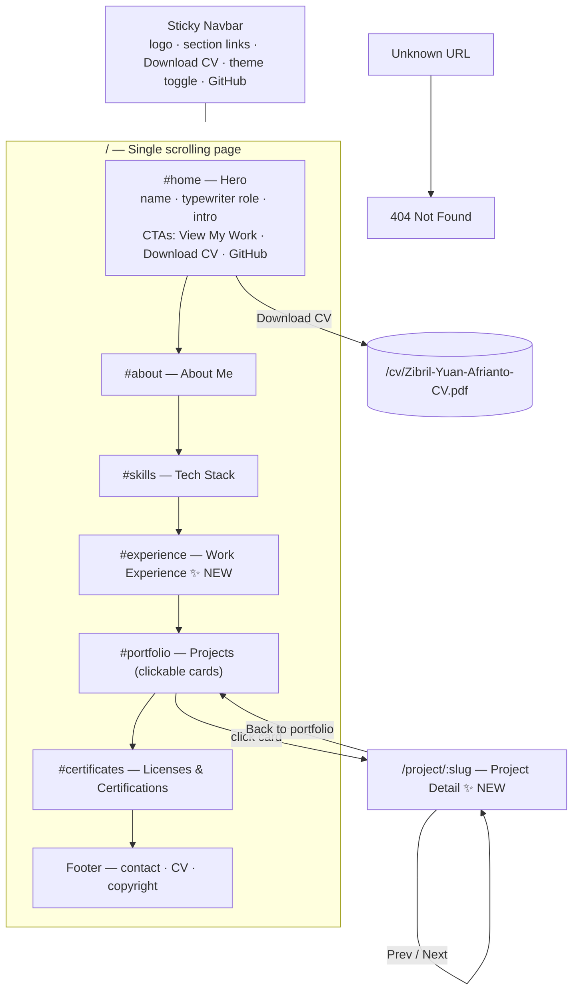
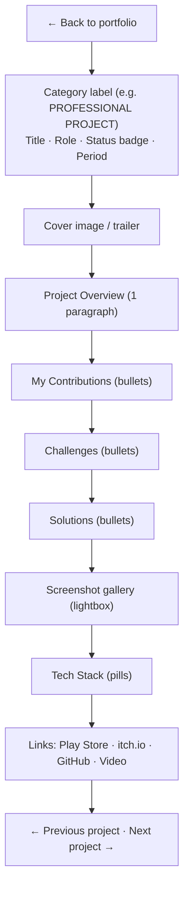
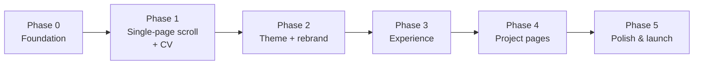

# PRD — Ea Portfolio v2: Single-Page Scroll, Work Experience, Cosmic Theme, Project Pages & CV

| | |
|---|---|
| **Owner** | Zibril Yuan Afrianto (ea) |
| **Status** | Draft (rev. 2: added CV download and project detail pages) |
| **Last updated** | 2026-10-20 |
| **Hosting** | Netlify |
| **Reference** | https://www.widwickyy.net/ |

---

## 1. Background

The current site (Vue 3 + Vue Router + Tailwind, Vue CLI) is a **multi-route app**: Home, About, Portfolio and Certificate are separate pages. To see the next one, a visitor has to click a nav link. The site has a single dark/amber theme. There's no way to show work history, projects are only a short card each, and a recruiter can't take a CV away with them.

Most recruiters spend less than a minute on a portfolio. A single scrolling page lets them see everything without hunting for links, and it reads as a story: *who I am → what I know → where I've worked → what I've built → proof*. Interviewers who want more depth can open a **project page** that explains the role, the problems and the engineering decisions, and anyone can **download the CV** in one click.

## 2. Goals

| # | Goal | Success signal |
|---|---|---|
| G1 | The whole portfolio is consumable by **scrolling alone** | Every section is reachable on one page; nav clicks smooth-scroll to sections |
| G2 | Show **professional work experience** | An Experience timeline sits directly after Tech Stack |
| G3 | **Dark & light themes** with a new **cosmic blue + white** identity | Toggle works, choice persists, and both themes pass WCAG AA contrast |
| G4 | **Downloadable CV** | A CV button in the hero and navbar downloads the latest PDF |
| G5 | **A dedicated page per project** that shows engineering depth | Clicking a project card opens `/project/<slug>` with role, overview, contributions, challenges, solutions, tech and links |
| G6 | Don't break existing links or SEO | Old URLs (`/about`, `/portfolio`, `/certificate`) redirect to their sections |

### Non-goals (this release)
- Blog/articles (the existing unused `BlogView`/`ArticleView` will be removed, not finished)
- A CMS or backend. Content stays as static data files in the repo.
- Project category filters and a contact form. These are candidates for v2.1 (see §9).

## 3. Target users

| User | Need |
|---|---|
| **Recruiter / HR** | Quickly confirm role, experience and seniority, **grab the CV**, find contact/GitHub |
| **Studio lead / tech interviewer** | **Read a project in depth**: what I owned, the problems I hit, how I solved them, the tech used, links to builds and repos |
| **Peers / game-jam teammates** | Browse games and play demos |

---

## 4. Information architecture

### 4.1 Site map (after)



### 4.2 Routes before → after

| Before | After |
|---|---|
| `/` HomeView | `/` with sections `#home`, `#about`, `#skills`, `#experience`, `#portfolio`, `#certificates` |
| `/about` | **301 →** `/#about` |
| `/portfolio` | **301 →** `/#portfolio` |
| `/certificate` | **301 →** `/#certificates` |
| — | `/project/:slug` **(new)**, e.g. `/project/mager-1-belum-produktif` |
| — | `/cv/Zibril-Yuan-Afrianto-CV.pdf` **(new static file)** |
| — | `/:pathMatch(.*)*` → 404 page **(new)** |

### 4.3 Proposed code structure

```
public/
  cv/Zibril-Yuan-Afrianto-CV.pdf
  img/projects/<slug>/cover.webp, 01.webp, 02.webp …
  _redirects  _headers        # Netlify
src/
  App.vue                     # <NavBar/> <router-view/> <SiteFooter/>
  views/
    HomeView.vue              # composes all sections
    ProjectDetailView.vue     # NEW: /project/:slug
    NotFoundView.vue          # NEW
  components/
    layout/NavBar.vue         # desktop top bar + mobile bottom bar, scroll-spy
    layout/SiteFooter.vue
    layout/ThemeToggle.vue
    sections/HeroSection.vue
    sections/AboutSection.vue
    sections/SkillsSection.vue
    sections/ExperienceSection.vue   # NEW
    sections/PortfolioSection.vue
    sections/CertificateSection.vue
    ui/ItemCard.vue           # shared by Portfolio + Certificate
    ui/SectionHeader.vue
    ui/TagPill.vue
    ui/CvButton.vue           # NEW: one source of truth for the CV link
    ui/ImageGallery.vue       # NEW: screenshots + lightbox on the detail page
  composables/
    useTheme.js               # theme state + persistence
    useScrollSpy.js           # IntersectionObserver → active section
    usePageMeta.js            # per-route <title>, description, OG tags
  data/
    profile.js  skills.js  experience.js  projects.js  certificates.js
```

---

## 5. Functional requirements

### F1 — Single-page scroll navigation

| ID | Requirement | Priority |
|---|---|---|
| F1.1 | All sections render one after another on a single page at `/`. Each section has a stable `id` (`home`, `about`, `skills`, `experience`, `portfolio`, `certificates`). | Must |
| F1.2 | Clicking a nav item **smooth-scrolls** to its section. The fixed navbar must not cover the section heading (use `scroll-margin-top` equal to the navbar height). | Must |
| F1.3 | The URL hash updates on nav click (`/#experience`), so sections can be linked to and shared. Opening a URL with a hash scrolls to that section on load. | Must |
| F1.4 | **Scroll-spy:** the nav item for the section currently in view is highlighted, on both the desktop top bar and the mobile bottom bar. | Must |
| F1.5 | Old routes `/about`, `/portfolio` and `/certificate` **301-redirect** to `/#about`, `/#portfolio` and `/#certificates` (Netlify `_redirects`). Add an SPA fallback `/* /index.html 200` as the last rule. | Must |
| F1.6 | Respect `prefers-reduced-motion`: jump instantly instead of smooth-scrolling, and disable entrance animations. | Must |
| F1.7 | Sections fade or slide in once when they enter the viewport (IntersectionObserver, no extra library). Replaces the current page-load animations. | Should |
| F1.8 | The hero has a "Scroll" cue and CTAs: **View My Work** (→ `#portfolio`), **Download CV** (F4), **GitHub**. | Should |
| F1.9 | When on a project page, nav section links route back to `/#<section>` and scroll there. | Must |
| F1.10 | The navbar gets a subtle background/blur once the page has scrolled past the hero. | Could |

**Acceptance criteria**
- Given I'm at the top of the page, when I click "Experience", the page scrolls smoothly until the Experience heading sits just below the navbar, and "Experience" is highlighted.
- Given I open `https://<site>/about`, I land on `/#about` with the About section in view.
- Given I'm on `/project/elker-2043`, when I click "Experience" in the nav, I go to `/` and land on the Experience section.

### F2 — Work Experience section (new)

Placed **directly after Tech Stack**.

| ID | Requirement | Priority |
|---|---|---|
| F2.1 | A vertical **timeline**: a line on the left with a dot per job, newest job first. | Must |
| F2.2 | Each entry shows: **period** (`SEP 2025 – PRESENT`), **role**, **company** (optional link), a one-line **summary**, 3–6 **highlight bullets**, and **tech tags** (pills). | Must |
| F2.3 | Content comes from `src/content/experience.js`. Adding a job means editing data only, never the template. | Must |
| F2.4 | Optional per-entry fields: `type` (Full-time / Internship / Freelance / Contract), `location` (Remote / city), `logo`. | Should |
| F2.5 | On mobile the timeline stays left-aligned and readable (no zig-zag layout). | Must |

**Data schema**

```js
// src/content/experience.js
export default [
  {
    id: 'company-slug',
    role: 'Unity Programmer',
    company: 'Company Name',
    companyUrl: 'https://…',          // optional
    type: 'Full-time',                // optional
    location: 'Remote',               // optional
    start: '2025-09',                 // ISO year-month
    end: null,                        // null = "Present"
    summary: 'One-sentence impact statement.',
    highlights: ['Built X which improved Y by Z.', '…'],
    tags: ['C#', 'Unity', 'Firebase']
  }
]
```

### F3 — Dark/light mode and cosmic blue rebrand

| ID | Requirement | Priority |
|---|---|---|
| F3.1 | A theme toggle (sun/moon icon) in the navbar, reachable on desktop and mobile. | Must |
| F3.2 | First visit follows the OS setting (`prefers-color-scheme`). After the user picks a theme, it's saved in `localStorage` and wins over the OS setting. | Must |
| F3.3 | **No flash of the wrong theme** on load: a tiny inline script in `index.html` sets the `dark` class on `<html>` before Vue mounts. | Must |
| F3.4 | Tailwind switches to `darkMode: 'class'`. Every color comes from **semantic tokens** (CSS variables), never hardcoded hex values in templates. | Must |
| F3.5 | **Both themes pass WCAG AA** (4.5:1 for body text, 3:1 for large text and UI). *This matters: the reference site's light mode has white headings on a white background, a bug we must not repeat.* | Must |
| F3.6 | The theme switch animates smoothly (≈200 ms color transition). | Should |
| F3.7 | Update the favicon, `theme-color` meta, scrollbar and text-selection colors to match the active theme. | Should |

**Palette proposal: "Cosmic Blue"** (final values to be tuned during implementation)

| Token | Light | Dark | Used for |
|---|---|---|---|
| `--bg` | `#F7F9FF` (cool white) | `#070B1A` (deep space) | Page background |
| `--surface` | `#FFFFFF` | `#0E1530` | Cards, navbar |
| `--surface-hover` | `#EEF2FF` | `#16204A` | Card hover |
| `--border` | `#DCE3F5` | `#1F2A55` | Card/section borders |
| `--text` | `#0B1530` | `#E8EDFF` | Headings, body |
| `--text-muted` | `#4A5578` | `#9AA6CC` | Secondary text |
| `--primary` | `#2747D6` (cosmic blue) | `#6B8BFF` | Links, active nav, CTAs, timeline dots |
| `--primary-fg` | `#FFFFFF` | `#070B1A` | Text on primary buttons |
| `--accent` | `#7C5CFF` (nebula violet) | `#9D86FF` | Gradients, highlights (sparingly) |
| `--tag-bg` | `#E6ECFF` | `#1A2558` | Tech pills |

The gradient text (currently slate→amber) becomes **`--primary` → `--accent`**. The amber `#ffdb70` is retired completely.

### F4 — Downloadable CV (new)

| ID | Requirement | Priority |
|---|---|---|
| F4.1 | A **Download CV** button in the hero (primary CTA next to "View My Work"), in the desktop navbar, and in the footer. On mobile it appears in the hero and the footer (the bottom tab bar stays section-only). | Must |
| F4.2 | The CV is a static PDF at a **stable URL**: `/cv/Zibril-Yuan-Afrianto-CV.pdf`. To update the CV, replace the file; no code change is needed. | Must |
| F4.3 | Clicking downloads the file with a clean filename (`download="Zibril-Yuan-Afrianto-CV.pdf"`). | Must |
| F4.4 | Netlify `_headers` sets a short cache on `/cv/*` (e.g. `Cache-Control: public, max-age=0, must-revalidate`), so a new CV shows up immediately after deploy. | Must |
| F4.5 | The button shows a download icon and an accessible label ("Download CV (PDF)"). The CV path lives in a single place (`src/content/profile.js` → `CvButton.vue`). | Must |
| F4.6 | The PDF is ≤ 1 MB, text-selectable (not a scanned image) and ATS-friendly. *(Content task for ea.)* | Should |
| F4.7 | A secondary "View" action opens the PDF in a new tab for people who'd rather preview it. | Could |
| F4.8 | Count downloads (Netlify Analytics or a lightweight event) to see whether recruiters use it. | Could |

**Acceptance criteria**
- Given I'm on any viewport, when I click "Download CV" in the hero, a PDF named `Zibril-Yuan-Afrianto-CV.pdf` downloads.
- Given ea replaces the PDF and redeploys, a visitor who downloaded the old one gets the new version on the next click.

### F5 — Project detail pages (new)

Following the reference, clicking a project card opens a **dedicated page** at `/project/:slug`.

**Page layout (top → bottom)**



| ID | Requirement | Priority |
|---|---|---|
| F5.1 | Each project has a unique, human-readable `slug`. Its page is reachable at `/project/<slug>`, both from the card and by opening the URL directly (SPA fallback on Netlify). | Must |
| F5.2 | The **whole portfolio card** is clickable (one link, keyboard-focusable), plus a "View details →" affordance. External icons on the card (GitHub / demo) keep working and don't trigger the card link. | Must |
| F5.3 | The page shows: back link, category, title, role, status, overview, contributions, tech stack, links (see layout above). | Must |
| F5.4 | **Challenges**, **Solutions**, **gallery**, **video** and **period** are optional. A section with no data isn't rendered (no empty headings). Older or small projects can launch with just an overview and contributions. | Must |
| F5.5 | **Back to portfolio** returns to `/#portfolio` and **restores the scroll position** of the card the user clicked (router `scrollBehavior` + saved position). | Must |
| F5.6 | Opening a project page always starts at the top of that page. | Must |
| F5.7 | An unknown slug renders the **404 page** (no blank screen). | Must |
| F5.8 | Per-page `<title>` (`Mager 1 — Zibril Yuan Afrianto`) and meta description from the project overview. | Must |
| F5.9 | Prev / Next project navigation at the bottom. | Should |
| F5.10 | Screenshot gallery with a lightbox (click to enlarge, Esc to close, arrow keys to step through). | Should |
| F5.11 | Embedded gameplay video (YouTube/itch) if `video` is set, lazy-loaded (thumbnail first, iframe on click). | Could |
| F5.12 | Social-preview (OG) tags per project. Netlify serves the SPA shell to crawlers, so this needs **pre-rendering** the project routes at build time (e.g. a prerender plugin, or `vite-ssg` after a Vite migration). | Could |
| F5.13 | The detail page respects the active theme and all F3 tokens. | Must |

**Data schema** (extends the current `items` in PortfolioView)

```js
// src/content/projects.js
export default [
  {
    slug: 'mager-1-belum-produktif',          // URL id, never changes once published
    title: 'Mager 1: Belum Produktif',
    category: 'Personal Project',             // Professional | Personal | School | Game Jam | Freelance
    role: 'Unity Programmer',
    status: 'Full Release',                   // Full Release | Demo | On Development | Postponed | Handover
    period: '2023',                           // optional
    featured: false,                          // optional, for v2.1
    cover: '/img/projects/mager-1-belum-produktif/cover.webp',
    summary: 'Short line used on the card.',
    overview: 'One paragraph for the detail page.',
    contributions: ['…'],
    challenges: ['…'],                        // optional
    solutions: ['…'],                         // optional
    gallery: ['/img/projects/mager-1-belum-produktif/01.webp'], // optional
    video: null,                              // optional (YouTube/itch embed URL)
    tech: ['C#', 'Unity Engine'],
    links: {                                  // all optional
      github: 'https://github.com/…',
      itch: 'https://….itch.io/…',
      playStore: null,
      instagram: null
    }
  }
]
```

> Note: this replaces the current `tech: 'Full Release | C#, Unity Engine'` string with separate `status` and `tech[]` fields, and replaces the `'null'` strings with real `null`.

**Acceptance criteria**
- Given I'm on `#portfolio`, when I click the "ELKER 2043" card, I land on `/project/elker-2043` at the top of the page, with title, role, overview and tech visible.
- Given I'm on that page, when I click "Back to portfolio", I return to the home page with the ELKER 2043 card in view.
- Given a project has no `challenges` data, no "Challenges" heading appears.
- Given I open `/project/does-not-exist`, I see the 404 page with a link home.
- Given I refresh on `/project/elker-2043` on Netlify, the page loads (no Netlify 404).

---

## 6. Non-functional requirements

| Area | Requirement |
|---|---|
| **Performance** | Lighthouse Performance ≥ 90 on mobile. A single page loads every section at once, so images **must** be optimized: WebP, sized to their display size, `loading="lazy"` below the fold. Card thumbnails ≈ 640 px wide, detail covers ≈ 1600 px. Target home-page image weight < 3 MB (currently ~25 MB). The project detail view is **lazy-loaded** (route-level code split). |
| **Accessibility** | Lighthouse a11y ≥ 95. Real `alt` text, keyboard-focusable nav, toggle, cards and lightbox, with visible focus rings. `aria-current` on the active nav item, `aria-label` on icon-only buttons, a "skip to content" link. Focus moves to the page `<h1>` after navigating to a project page. |
| **SEO** | `lang="en"`, meta description, Open Graph and Twitter card tags, a single `<h1>` per page, section `<h2>`s, per-route titles (F5.8). A `sitemap.xml` that includes the project pages. |
| **Responsive** | Usable from 360 px to 1440 px+. Mobile keeps the bottom tab bar. |
| **Browser support** | Last 2 versions of evergreen browsers (existing `browserslist`). |
| **Maintainability** | Content lives only in `src/content/*` and `public/` (CV, images). Component styles are `scoped`, with no global CSS leaks (fixes the current conflicting `fadeInLeft` keyframes and the global `svg:hover`). |

### Netlify config (target)

> Superseded by [SYSTEM_DESIGN.md §9](./SYSTEM_DESIGN.md#9-build-deploy--hosting), which moves this into `netlify.toml` and drops the SPA catch-all because all routes are pre-rendered. Kept here as the plain-SPA fallback.

```
# public/_redirects
/about        /#about          301
/portfolio    /#portfolio      301
/certificate  /#certificates   301
/*            /index.html      200

# public/_headers
/cv/*
  Cache-Control: public, max-age=0, must-revalidate
/img/*
  Cache-Control: public, max-age=31536000, immutable   # only if filenames are versioned
```

---

## 7. Release plan



| Phase | Scope | Notes |
|---|---|---|
| **0. Foundation** | Add `.gitignore` and untrack `node_modules`. Delete dead code (Blog, Article, HelloWorld, unused images). Move content into `src/content/` using the **F5 project schema** from the start. Extract `ItemCard`. Scope all styles. *(Optional: migrate Vue CLI → Vite.)* | No visible change. Makes every later phase cheaper. |
| **1. Single-page scroll + CV** | F1, F4, Netlify `_redirects` and `_headers` | CV is small, so it rides along. Needs the PDF from ea. |
| **2. Theme + rebrand** | F3, token system, re-skin every section | Contrast checked in both themes |
| **3. Experience** | F2, data filled in | Needs content from ea |
| **4. Project pages** | F5.1–F5.10, 404 page, `usePageMeta`, gallery | Can launch with overview + contributions only and fill challenges/solutions over time |
| **5. Polish & launch** | Image optimization, SEO/OG, sitemap, a11y pass, Lighthouse, F5.11–F5.12 if wanted, deploy preview → production | |

Each phase is its own branch and PR into `development`, verified on a Netlify deploy preview before merging.

---

## 8. Open questions (needs ea's input)

1. **Experience content:** the list of jobs with company, role, dates, summary, highlights and tech tags. Should internships and freelance work be included?
2. **CV file:** please provide the latest PDF. Is one English CV enough, or do you also want an Indonesian version (two buttons / a language picker)?
3. **Project page content:** for each of the 14 projects, the category, your role, an overview, contributions and (ideally) challenges/solutions, plus 2–5 screenshots. Which projects should get the full write-up first? Studio projects (Ghost Breaker, Tuyul Mantul, Labirin Alfabet, Skuadron Garuda) are the strongest candidates.
4. **Section order:** is *Hero → About → Tech Stack → Experience → Portfolio → Certificates* right, or should Portfolio come before Experience?
5. **Default theme:** follow the OS (proposed), or always start in dark?
6. **Content refresh:**
   - The Unity Certified Associate certificate shows *Jun 2023 – Jun 2026* and is now expired. Keep it, mark it expired, or remove it?
   - The About bio says "fresh graduate" next to "3+ years experience". Do you want to update it?
   - Skuadron Garuda uses the same Play Store link as Labirin Alfabet. Is that correct?
7. **Branding:** keep "Zibril Portfolio" as the logo text, or switch to a monogram/logo like the reference?
8. **Vite migration in Phase 0:** yes or no? (Recommended. It also makes pre-rendering the project pages for social previews, F5.12, much easier.)

## 9. Future (v2.1+)

- Project category filters with counts (All / Professional / Personal / School / Game Jam / Freelance), as on the reference site. The `category` field is already in the F5 schema.
- "Featured" badge and a larger hero card for top projects (the `featured` field is already in the schema)
- Contact section (email / LinkedIn / itch.io)
- Certificate detail view or a verification-link lightbox
