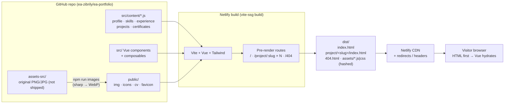
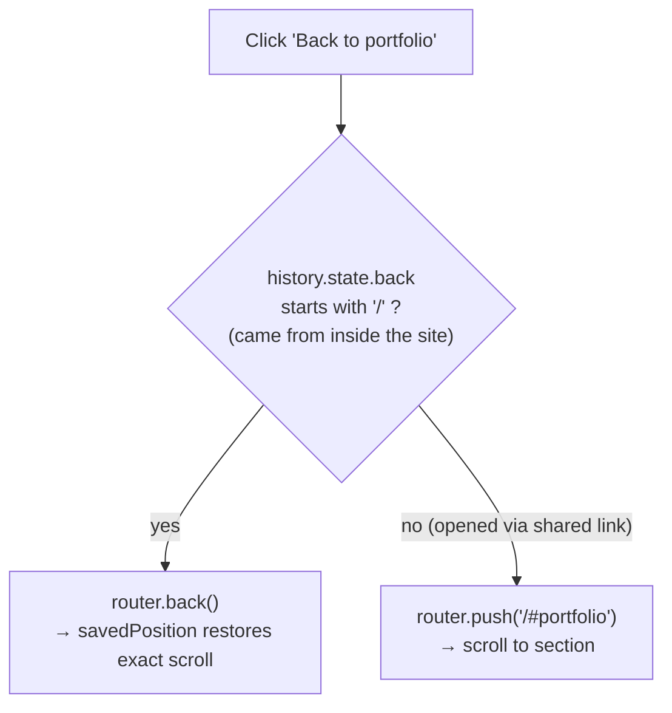
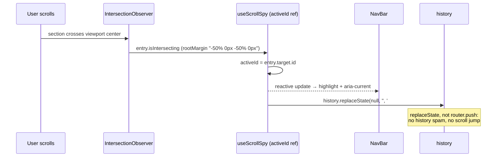
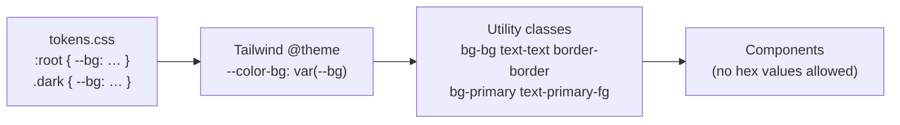
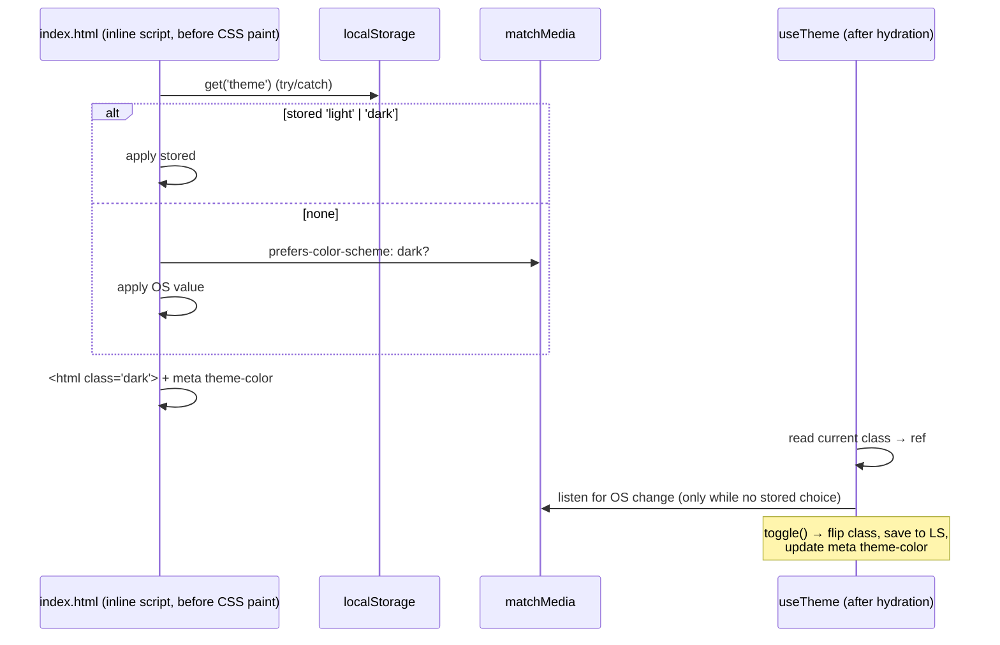
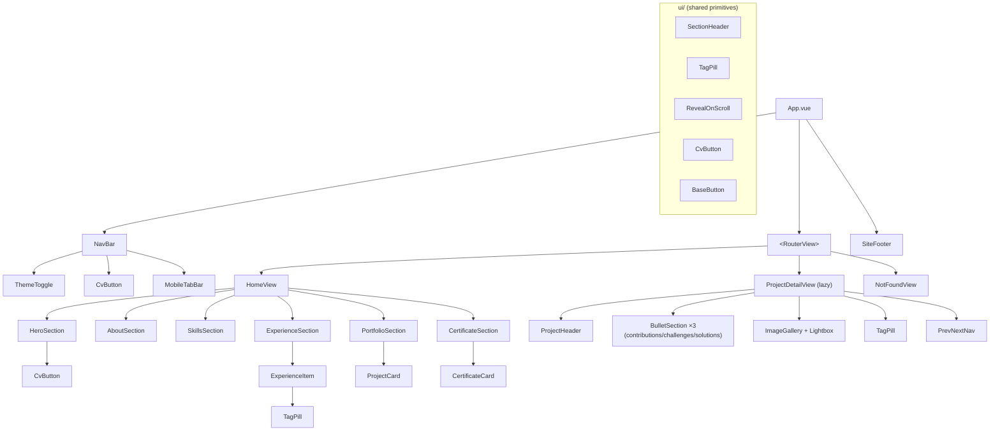
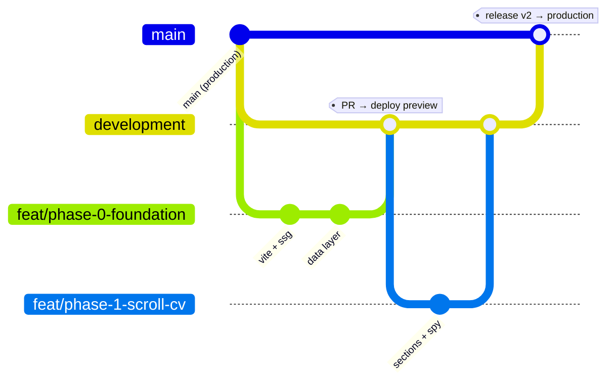

# System Design — Ea Portfolio v2

| | |
|---|---|
| **Owner** | Zibril Yuan Afrianto (ea) |
| **Status** | Draft |
| **Last updated** | 2026-10-20 |
| **Implements** | [PRD.md](./PRD.md) (F1–F5) |

> Decisions marked **⏳ pending** depend on open PRD questions (§8). The design uses the recommended option. If ea picks differently, only the noted sections change.

---

## 1. Overview

The portfolio is a **static site**: no backend, no database, no runtime API. All content is versioned in the repo as JS data files and static assets. The design goals, in priority order:

1. **Content is data.** Adding a job, project or certificate means editing `src/content/*` only.
2. **Static-first.** Every page is pre-rendered to real HTML at build time, so links preview properly and load fast. Vue then takes over in the browser.
3. **Small, boring stack.** No state library, no UI kit, no animation library. Plain Vue, Tailwind and browser APIs (IntersectionObserver, matchMedia, localStorage).
4. **Code that's safe to pre-render.** Anything that touches `window`, `document` or `localStorage` runs only in the browser (`onMounted`, or behind a `typeof window` guard).

---

## 2. Architecture decisions (ADRs)

| # | Decision | Chosen | Alternatives considered | Why |
|---|---|---|---|---|
| ADR-1 | Build tool | **Vite** (replacing Vue CLI) ⏳ pending | Keep Vue CLI | Vue CLI is in maintenance mode. Vite gives instant dev server and faster builds, and it's required by the pre-renderer in ADR-2. The codebase is ~1.3k LOC, so migration is cheap now and expensive later. |
| ADR-2 | Rendering | **Static Site Generation via `vite-ssg`** | Plain SPA + Netlify fallback; Nuxt | Gives real HTML per route (`/`, `/project/<slug>`), so social previews (PRD F5.12) and SEO work and first paint is fast. Much lighter than switching to Nuxt, and it keeps Vue Router as-is. |
| ADR-3 | Routing | **Vue Router 4**, history mode, 3 routes + hash sections | Single route with only anchors | Project pages need real URLs (F5.1). Home sections use hash anchors handled by a custom `scrollBehavior`. |
| ADR-4 | Styling | **Tailwind CSS v4** + CSS custom-property tokens | Tailwind 3.4; plain CSS | v4's CSS-first `@theme` maps cleanly onto design tokens, and `@custom-variant dark` gives class-based dark mode. The whole theme is being rewritten anyway, so the upgrade costs nothing extra. Requires Safari ≥ 16.4 / Chrome ≥ 111, which is fine for this audience. |
| ADR-5 | State | **Composables + module-level `ref`s** | Pinia | Only two pieces of global state exist (theme, active section). Pinia would be overkill. |
| ADR-6 | Content | **Static ES modules** in `src/content/` | Markdown + frontmatter; headless CMS | Tree-shakable, type-friendly, no parser. Long-form project text is still short enough for JS strings. Can be revisited if project write-ups grow into articles. |
| ADR-7 | Images | **Pre-optimized WebP committed to `public/img/`**, generated by a `sharp` script | `vite-imagetools` at build time | Simple mental model (one path string in the data file), fast Netlify builds, and no import plumbing in the data files. The trade-off is that filenames aren't content-hashed, so the cache is shorter (§9). |
| ADR-8 | Fonts & icons | **Self-hosted** Poppins (`@fontsource/poppins`) and tech-logo SVGs in `public/icons/` | Google Fonts and hotlinked logos (current) | Removes render-blocking third-party requests and broken-image risk, and stops leaking visitor IPs to third parties. |
| ADR-9 | Hosting / CI | **Netlify** (existing), configured via `netlify.toml`. Deploy previews per PR. | GitHub Pages; Vercel | Already in use. `netlify.toml` keeps build, redirect and header config versioned in one file. |
| ADR-10 | Quality gates | **ESLint (flat config) + Prettier + Vitest**, with Playwright smoke tests (optional) | None (current) | Data-validation tests catch broken slugs and missing images before deploy. That's the most likely real-world bug in a content-driven site. |

---

## 3. High-level architecture



**Request lifecycle:** the browser requests `/project/elker-2043`. Netlify serves the pre-rendered `project/elker-2043/index.html` (full content, OG tags). JS loads and Vue hydrates the page, and from then on navigation is client-side (no full reloads).

---

## 4. Routing & navigation design

### 4.1 Route table

| Path | Component | Pre-rendered | Notes |
|---|---|---|---|
| `/` | `HomeView` | ✅ | All sections. Hash anchors: `#home #about #skills #experience #portfolio #certificates` |
| `/project/:slug` | `ProjectDetailView` (lazy chunk) | ✅ one file per slug in `projects.js` | Unknown slug → renders `NotFoundView` |
| `/:pathMatch(.*)*` | `NotFoundView` | ✅ as `404.html` | Netlify serves `404.html` with status 404 automatically |

The section ids live in one place, `src/content/sections.js`. Both the navbar and `useScrollSpy` read from that list, so a section can't be renamed in one place and forgotten in another.

```js
// src/content/sections.js
export default [
  { id: 'home',         label: 'Home' },
  { id: 'about',        label: 'About' },
  { id: 'skills',       label: 'Skills' },
  { id: 'experience',   label: 'Experience' },
  { id: 'portfolio',    label: 'Portfolio' },
  { id: 'certificates', label: 'Certificates' },
]
```

### 4.2 `scrollBehavior` (router)

```js
scrollBehavior(to, from, savedPosition) {
  const reduce = window.matchMedia('(prefers-reduced-motion: reduce)').matches
  const behavior = reduce ? 'auto' : 'smooth'

  if (savedPosition) return savedPosition                 // browser back/forward → exact restore
  if (to.hash) return { el: to.hash, behavior }           // offset handled by CSS scroll-margin-top
  if (to.name === 'project') return { top: 0 }            // F5.6
  return { top: 0 }
}
```

- **Navbar offset:** every section has `scroll-mt-[var(--nav-h)]`, and `--nav-h` is set once in CSS. This avoids hard-coding offsets in JS.
- **Cross-page anchor (F1.9):** on a project page, nav links are `<RouterLink :to="{ path: '/', hash: '#experience' }">`. The home view mounts and the router scrolls to the element. If the element isn't in the DOM yet, it's retried in `nextTick`.

### 4.3 "Back to portfolio" (F5.5)



Each portfolio card also gets `id="project-<slug>"`. This allows a precise fallback (`/#project-<slug>`) if needed later.

### 4.4 Scroll-spy (F1.4)



- One observer watches all sections. Using the viewport's center line as the trigger means exactly one section is active at a time, which avoids flicker.
- It's disconnected in `onBeforeUnmount`. It only runs on `HomeView`.
- **Nav-click lock:** during a programmatic smooth scroll, spy updates are paused (a flag is cleared on `scrollend`, with a 1 s fallback timer), so the highlight doesn't flicker through intermediate sections.

---

## 5. Theming design (F3)

### 5.1 Token pipeline



```css
/* src/styles/tokens.css */
:root {
  --bg: #F7F9FF; --surface: #FFFFFF; --surface-hover: #EEF2FF; --border: #DCE3F5;
  --text: #0B1530; --text-muted: #4A5578;
  --primary: #2747D6; --primary-fg: #FFFFFF; --accent: #7C5CFF; --tag-bg: #E6ECFF;
  --nav-h: 4rem;
  color-scheme: light;
}
.dark {
  --bg: #070B1A; --surface: #0E1530; --surface-hover: #16204A; --border: #1F2A55;
  --text: #E8EDFF; --text-muted: #9AA6CC;
  --primary: #6B8BFF; --primary-fg: #070B1A; --accent: #9D86FF; --tag-bg: #1A2558;
  color-scheme: dark;
}

/* src/styles/main.css */
@import "tailwindcss";
@import "./tokens.css";
@custom-variant dark (&:where(.dark, .dark *));
@theme inline {
  --color-bg: var(--bg);           --color-surface: var(--surface);
  --color-surface-hover: var(--surface-hover);  --color-border: var(--border);
  --color-text: var(--text);       --color-text-muted: var(--text-muted);
  --color-primary: var(--primary); --color-primary-fg: var(--primary-fg);
  --color-accent: var(--accent);   --color-tag: var(--tag-bg);
  --font-sans: "Poppins", ui-sans-serif, system-ui, sans-serif;
}
```

Because components only use semantic classes (`bg-surface`, `text-text-muted`), **both themes come for free**. `dark:` variants are needed only for rare exceptions such as image treatments. The ESLint rule `no-restricted-syntax` (or a simple CI grep) flags `#[0-9a-f]{3,6}` or `bg-[#` inside `.vue` templates.

### 5.2 Theme resolution & no-flash boot



```html
<!-- index.html <head>, before any stylesheet -->
<script>
  (function () {
    try {
      var s = localStorage.getItem('theme');
      var d = s ? s === 'dark' : matchMedia('(prefers-color-scheme: dark)').matches;
      document.documentElement.classList.toggle('dark', d);
    } catch (e) {}
  })();
</script>
```

- The pre-rendered HTML ships **without** the `dark` class, and the inline script decides before first paint. Vue hydration doesn't touch `<html>`'s class, so there's no hydration mismatch.
- The 200 ms theme transition is applied only on toggle: a `theme-transition` class is added to `<html>` for 250 ms. This prevents an animated flash on page load.

---

## 6. Data layer

### 6.1 Files & ownership

| File | Shape | Consumed by |
|---|---|---|
| `profile.js` | `{ name, roles[], intro, bio[], avatar, github, email, linkedin, cv: { href, filename } }` | Hero, About, Footer, CvButton, meta tags |
| `sections.js` | `[{ id, label }]` | NavBar, useScrollSpy |
| `skills.js` | `[{ id, name, icon, level }]` | SkillsSection |
| `experience.js` | PRD F2 schema | ExperienceSection |
| `projects.js` | PRD F5 schema | PortfolioSection, ProjectDetailView, vite-ssg route list, sitemap |
| `certificates.js` | `[{ id, name, issuer, issued, expires, image, credentialUrl }]` | CertificateSection |

### 6.2 Derived helpers (`src/lib/`)

`src/content/` holds plain data only. All logic over it lives in pure, unit-tested modules in `src/lib/` (see PROJECT_RULES §2.4).

```js
// src/lib/projects.js
export const projectsBySlug = new Map(projects.map(p => [p.slug, p]))
export const getProject = slug => projectsBySlug.get(slug) ?? null
export const getAdjacent = slug => { /* prev/next for F5.9, wraps around */ }

// src/lib/format.js
export const formatPeriod = (start, end) => /* '2025-09', null → 'SEP 2025 – PRESENT' */
export const isExpired = cert => cert.expires && new Date(cert.expires) < new Date()
```

`isExpired` means an expired certificate is flagged automatically, which handles the Unity Associate case without editing the data.

### 6.3 Validation (build-time safety net)

`tests/content.spec.js` (Vitest) runs in CI and fails the build if:
- any `slug` is duplicated or isn't kebab-case;
- a required field is missing (per the PRD schemas);
- any `cover`, `gallery[]`, `image` or `icon` path doesn't exist under `public/`;
- the CV file referenced in `profile.cv.href` doesn't exist;
- a URL in `links` isn't `https://`.

---

## 7. Component architecture



**Conventions**
- `<script setup>` and the Composition API everywhere (the current Options API code is migrated as it's touched).
- **All `<style>` blocks are `scoped`.** Global CSS lives only in `src/styles/` (tokens, base, keyframes). This fixes the current keyframe collisions.
- Each section is wrapped in `<section :id aria-labelledby>` with an `<h2>`. Only the hero (home) and the project title (detail page) use `<h1>`.
- `ProjectCard` and `CertificateCard` replace the duplicated templates from `PortfolioView` and `CertificateView`. They share a base `ItemCard` layout component.
- `RevealOnScroll` is a wrapper component that uses one shared IntersectionObserver. It adds an `is-visible` class once, and does nothing under reduced motion.

### Composables

| Composable | Responsibility | Pre-render safe |
|---|---|---|
| `useTheme()` | `theme` ref, `toggle()`, persistence, OS listener | Reads the DOM only in `onMounted` |
| `useScrollSpy(ids)` | `activeId` ref, observer lifecycle, hash sync, nav-click lock | Observer created in `onMounted` |
| `usePageMeta({ title, description, image })` | Per-route `<title>`, description, OG/Twitter tags | Uses `@unhead/vue` (bundled with vite-ssg), so it works both when pre-rendering and in the browser |
| `useReducedMotion()` | Reactive `prefers-reduced-motion` | Defaults to `false` during pre-rendering |

---

## 8. Asset pipeline

### 8.1 Images

```
assets-src/                       # originals, committed, NOT deployed
  projects/<slug>/cover.png, 01.png …
  certificates/<id>.png
  profile/avatar.png
        │  npm run images   (scripts/optimize-images.mjs, sharp)
        ▼
public/img/
  projects/<slug>/cover-640.webp  cover-1600.webp  01-1280.webp …
  certificates/<id>-640.webp
  profile/avatar-480.webp
```

- Widths: cards 640 px, detail cover 1600 px, gallery 1280 px, WebP quality ~80.
- Templates use `srcset` with the 640/1600 pair and `sizes`, plus explicit `width`/`height` to prevent layout shift.
- The hero avatar gets `fetchpriority="high"`. Everything below the fold gets `loading="lazy" decoding="async"`.
- **Budget:** home page total image weight < 3 MB (today: ~25 MB). The script prints a size report and warns on any output over 300 KB.

### 8.2 CV

- `public/cv/Zibril-Yuan-Afrianto-CV.pdf`. The path comes from `profile.cv`.
- `<a :href="cv.href" :download="cv.filename">`. This works because the file is served from the same site.
- Short cache via headers (§9), so replacing the file takes effect on the next deploy.

### 8.3 Fonts & icons

- `@fontsource/poppins` weights 400/500/600/700 (latin subset). `font-display: swap`.
- Tech icons are downloaded once into `public/icons/tech/*.svg` (from devicon, MIT license). No more hotlinking from logo.wine or cdnlogo.

---

## 9. Build, deploy & hosting

### 9.1 `netlify.toml`

```toml
[build]
  command = "npm run build"        # vite-ssg build
  publish = "dist"

[build.environment]
  NODE_VERSION = "22"

# Legacy routes → sections (PRD F1.5)
[[redirects]]
  from = "/about"
  to = "/#about"
  status = 301
[[redirects]]
  from = "/portfolio"
  to = "/#portfolio"
  status = 301
[[redirects]]
  from = "/certificate"
  to = "/#certificates"
  status = 301
# No SPA catch-all needed: every route is pre-rendered, and unknown paths get 404.html with a real 404 status.

[[headers]]
  for = "/assets/*"                # Vite output, content-hashed
  [headers.values]
    Cache-Control = "public, max-age=31536000, immutable"
[[headers]]
  for = "/img/*"                   # not hashed → moderate cache
  [headers.values]
    Cache-Control = "public, max-age=604800"
[[headers]]
  for = "/cv/*"
  [headers.values]
    Cache-Control = "public, max-age=0, must-revalidate"
[[headers]]
  for = "/*"
  [headers.values]
    X-Content-Type-Options = "nosniff"
    Referrer-Policy = "strict-origin-when-cross-origin"
    X-Frame-Options = "DENY"
```

> Netlify `redirects` rules are applied before static files, but they only fire for paths with no existing file. `/about` has no file after v2, so the 301 applies.

### 9.2 Branch & deploy flow



- `main` = production (Netlify production branch). `development` = integration branch. Each phase has its own `feat/*` branch, and its PR into `development` gets a Netlify **deploy preview**.
- Optional GitHub Action on every PR: `npm ci && npm run lint && npm test && npm run build`. Netlify also blocks a deploy if the build fails.

### 9.3 npm scripts

| Script | Does |
|---|---|
| `dev` | `vite` dev server |
| `build` | `vite-ssg build` → `dist/` (includes sitemap generation) |
| `preview` | Serve `dist/` locally (same output as production) |
| `lint` / `format` | ESLint / Prettier |
| `test` | Vitest (data validation and composables) |
| `test:e2e` | Playwright smoke tests (optional) |
| `images` | Optimize `assets-src/` → `public/img/` |

---

## 10. SEO & metadata

| Item | Implementation |
|---|---|
| Per-route title/description | `usePageMeta` → `@unhead/vue`; rendered into the static HTML at build time |
| Open Graph / Twitter | Home uses `og-default.png` (1200×630). Project pages use the project cover (1600 w) |
| Canonical URL | `https://<domain>/` and `https://<domain>/project/<slug>` |
| `sitemap.xml` | Generated after the build from `projects.js` + `/` |
| `robots.txt` | Allow all + sitemap link |
| Structured data | `Person` JSON-LD on home (name, jobTitle, sameAs: GitHub/LinkedIn/itch) |
| `lang` | `<html lang="en">` |

---

## 11. Quality: testing, accessibility, performance

### Testing pyramid (kept deliberately small)

| Layer | Tool | What |
|---|---|---|
| Static | ESLint, Prettier | Code style, Vue rules, no hardcoded colors |
| Unit | Vitest | `content.spec.js` (§6.3), `formatPeriod`, `isExpired`, `getAdjacent`, `useTheme` resolution logic |
| E2E smoke | Playwright (optional) | ① Nav click scrolls to and highlights Experience ② theme toggle persists across reload ③ card → detail → back restores position ④ `/about` → `/#about` (on deploy preview) ⑤ CV link returns `200 application/pdf` ⑥ unknown slug → 404 |

### Budgets (checked in Lighthouse on the deploy preview, mobile)

| Metric | Target |
|---|---|
| Performance | ≥ 90 |
| Accessibility | ≥ 95 |
| Best Practices / SEO | ≥ 95 |
| LCP | < 2.5 s |
| CLS | < 0.05 |
| JS (gzip, home) | < 120 KB |
| Images (home) | < 3 MB |

### Accessibility checklist
- Contrast is checked for **every** token pair in **both** themes, documented in a table inside `tokens.css`.
- Visible `:focus-visible` ring using `--primary`. Skip-link to `<main>`.
- `aria-current="true"` on the active nav item. `aria-pressed` and `aria-label` on the theme toggle.
- Lightbox: focus trap, `Esc` to close, arrow keys to navigate, focus returns to the thumbnail that opened it.
- After route change to a project page, focus moves to its `<h1>` (`tabindex="-1"`).

---

## 12. Implementation plan (maps to PRD §7)

| Phase | Technical tasks | Definition of done |
|---|---|---|
| **0. Foundation** | `.gitignore`, `git rm -r --cached node_modules` · Vue CLI → Vite + vite-ssg · Tailwind v4 + `tokens.css` (current amber values for now) · ESLint flat config, Prettier, Vitest · create `src/content/*` with the new schemas, migrate the current content · `ItemCard` extraction · scope all styles · delete dead code and unused assets · `scripts/optimize-images.mjs` + run it · self-host fonts and icons · `netlify.toml` | Site looks the same as today, builds with `vite-ssg`, `npm test` is green, repo has no `node_modules` |
| **1. Scroll + CV** | `sections.js` · section components · `HomeView` composition · `NavBar` + `MobileTabBar` · `useScrollSpy` · router `scrollBehavior` · `RevealOnScroll` · `CvButton` + `profile.cv` · legacy 301s | PRD F1 + F4 acceptance criteria pass on deploy preview |
| **2. Theme** | Final token values + contrast table · `useTheme` + inline boot script · `ThemeToggle` · re-skin all sections · favicon, `theme-color`, scrollbar, selection colors | Both themes pass AA, no flash on reload, choice persists |
| **3. Experience** | `experience.js` content · `ExperienceSection` + `ExperienceItem` + `TagPill` · `formatPeriod` | PRD F2 acceptance criteria |
| **4. Project pages** | `/project/:slug` route + `includedRoutes` for SSG · `ProjectDetailView`, `ProjectHeader`, `BulletSection`, `ImageGallery`, `PrevNextNav` · `NotFoundView` · back-navigation logic · `usePageMeta` | PRD F5 acceptance criteria. Every slug pre-renders to its own HTML file |
| **5. Polish & launch** | OG images, sitemap, robots, JSON-LD · Lighthouse pass against budgets · Playwright smoke · merge `development` → `main` | Budgets met. Production verified after deploy |

---

## 13. Risks & mitigations

| Risk | Impact | Mitigation |
|---|---|---|
| Browser-only code (`window`, `localStorage`) runs during pre-rendering and breaks the build | Build fails | Keep all DOM access in `onMounted` or composables. Phase 0 sets this up, so the issue shows up early on a small codebase |
| `vite-ssg` lags behind a new Vite major version | Can't upgrade Vite | Pin compatible versions. Fallback is plain SPA + Netlify `/* /index.html 200` (loses only per-project social previews) |
| Scroll-spy flicker during smooth scroll | Janky nav | Nav-click lock (§4.4) |
| Fixed navbar covers anchored headings | Poor UX | `scroll-margin-top: var(--nav-h)`. Single source for nav height |
| Image weight creeps back as projects are added | Slow site | Size report + warning in `npm run images`. Data test fails if a `cover` isn't `.webp` |
| Recruiters download a stale CV | Wrong info shared | `max-age=0, must-revalidate` on `/cv/*`, and a stable filename |
| Content for 14 project pages takes time | Phase 4 stalls | Optional sections render nothing when empty. Ship minimal pages and enrich over time |
| Light-mode contrast regressions (seen on the reference site) | Unreadable text | Semantic tokens only, a lint rule against hex values, and the contrast table checked in every PR touching tokens |

---

## 14. Final directory layout

The canonical tree, root cleanup table and placement rules live in [PROJECT_RULES.md §2](./PROJECT_RULES.md#2-folder-structure). This is the component-level detail inside `src/`:

```
src/
├─ main.js                  # ViteSSG(App, { routes, scrollBehavior })
├─ App.vue                  # layout shell only
├─ router/      routes.js · scroll-behavior.js
├─ views/       HomeView · ProjectDetailView · NotFoundView
├─ components/
│  ├─ layout/   NavBar · MobileTabBar · SiteFooter · ThemeToggle
│  ├─ sections/ HeroSection · AboutSection · SkillsSection · ExperienceSection · PortfolioSection · CertificateSection
│  ├─ project/  ProjectHeader · BulletSection · ImageGallery · PrevNextNav
│  └─ ui/       ItemCard · ProjectCard · CertificateCard · SectionHeader · TagPill · CvButton · BaseButton · RevealOnScroll
├─ composables/ useTheme · useScrollSpy · usePageMeta · useReducedMotion   (+ *.spec.js)
├─ content/     profile · sections · skills · experience · projects · certificates
├─ lib/         format · projects   (+ *.spec.js)
└─ styles/      main.css · tokens.css · base.css · animations.css
```
