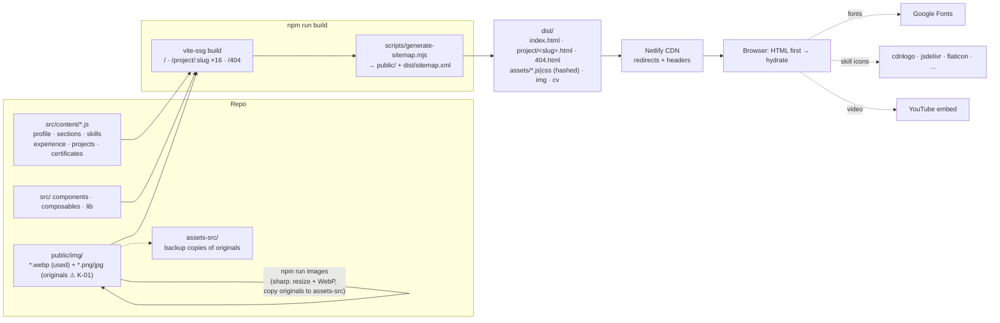
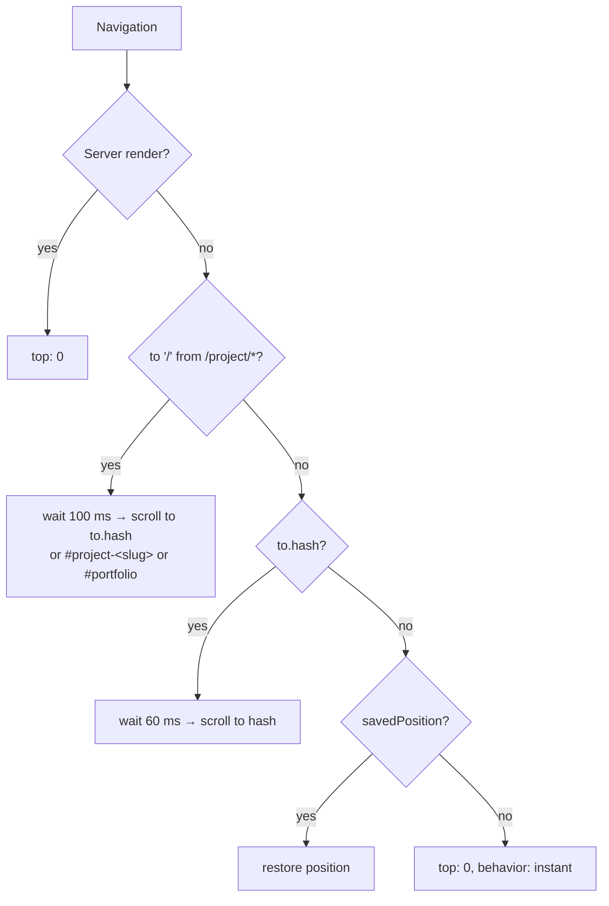
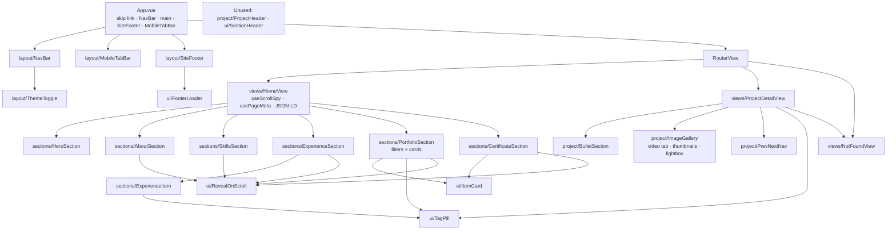

# System Design — Ea Portfolio v2

| | |
|---|---|
| **Owner** | Zibril Yuan Afrianto (ea) |
| **Status** | **As built**. Describes `development` @ `418f5d8f` |
| **Last updated** | 2026-11-16 |
| **Implements** | [PRD.md](./PRD.md) (F1–F6) |

> Rev. 3 note: this document was originally a plan (2026-10-20). It has been rewritten to describe what was actually built. Where the build differs from the plan, the difference is marked **Δ** with the reason, if known.

---

## 1. Overview

A **static site**: no backend, no database, no runtime API. All content lives in the repo as JS modules plus static assets. Every route is pre-rendered to HTML at build time, and Vue takes over in the browser.

Principles (unchanged):
1. **Content is data.** Editing a job, project or certificate only touches `src/content/*`.
2. **Static-first.** Real HTML per route, for SEO, link previews and fast first paint.
3. **Small stack.** Vue, Vue Router, Tailwind, `@unhead/vue`. No state library, UI kit or animation library.
4. **Pre-render safe.** Browser APIs only in `onMounted`, handlers, or guarded composables.

---

## 2. Architecture decisions

| # | Decision | As built | Δ vs plan |
|---|---|---|---|
| ADR-1 | Build tool | **Vite 6** | — |
| ADR-2 | Rendering | **vite-ssg 28** pre-renders `/`, every `/project/<slug>`, and `/404` | — |
| ADR-3 | Routing | **Vue Router 4**, history mode, hash sections on home | **Δ** Legacy redirects also exist as router routes (a fallback for client-side navigation) |
| ADR-4 | Styling | **Tailwind v4** via `@tailwindcss/vite`. Tokens are CSS variables mapped in `@theme inline` | — |
| ADR-5 | State | Module-level `ref`s inside composables (`useTheme`, `useScrollSpy`) | — |
| ADR-6 | Content | Static ES modules in `src/content/` | — |
| ADR-7 | Images | `sharp` script → **one WebP per image, same folder, flat names** (`public/img/portfolio-<name>.webp`) | **Δ** The plan was per-slug folders, multiple widths and `srcset`, with `assets-src/` as the only source. As built, the script reads from `public/img/`, copies originals to `assets-src/`, and leaves the originals in `public/img/` (see K-01) |
| ADR-8 | Fonts & icons | **Inter + Roboto Mono from Google Fonts.** Skill icons hotlinked from CDNs | **Δ** The plan was self-hosted Poppins and local SVG icons. The font changed for the new monochrome look. `@fontsource/poppins` is still installed but unused (K-14, K-15) |
| ADR-9 | Hosting | Netlify via `netlify.toml`, Node 22 | — |
| ADR-10 | Quality gates | **Vitest only** (6 spec files, 21 tests) | **Δ** No ESLint, Prettier (only the config block in `package.json`), CI or Playwright yet (K-08) |
| ADR-11 | Visual identity | **Monochrome tokens** (Notion/Linear-inspired) | **Δ New.** Replaced the cosmic blue palette. Token names unchanged |

---

## 3. High-level architecture



Pre-rendered project pages are flat files (`dist/project/elker-2043.html`). Netlify's pretty-URL handling serves them at `/project/elker-2043`.

---

## 4. Routing & navigation

### 4.1 Route table (`src/router/routes.js`)

| Path | Component | Pre-rendered |
|---|---|---|
| `/` | `HomeView` (eager) | ✅ |
| `/project/:slug` (name `project`) | `ProjectDetailView` (lazy) | ✅ one per slug via `ssgOptions.includedRoutes` in `vite.config.js` |
| `/about`, `/portfolio`, `/certificate` | redirect → `/#about`, `/#portfolio`, `/#certificates` | — (Netlify 301 handles direct hits) |
| `/404` (name `not-found`) | `NotFoundView` (lazy) | ✅ as `404.html` |
| `/:pathMatch(.*)*` | `NotFoundView` | — |

An unknown slug under `/project/` renders `NotFoundView` inside `ProjectDetailView`.

### 4.2 Section registry

`src/content/sections.js` is the single list of section ids and labels. It's used by `NavBar`, `MobileTabBar` and `useScrollSpy`.

### 4.3 Scroll behavior (`src/router/scroll-behavior.js`)



- `behavior` is `smooth`, or `auto` under reduced motion.
- The delays give the home view time to mount (and lazy chunks time to resolve) before the scroll.
- **Back to portfolio:** `ProjectDetailView.handleBack()` calls `router.push({ path: '/', hash: '#project-<slug>' })`. Each card has `id="project-<slug>"` and `scroll-mt-[calc(var(--nav-h)+1.5rem)]`. **Δ** The plan used `router.back()` when possible. Pushing a hash is simpler, but it adds a history entry and resets the filter (K-11).

### 4.4 Scroll-spy (`useScrollSpy`)

- Shared module-level `activeId` (so `NavBar`, `MobileTabBar`, `SiteFooter`, `HeroSection` and `HomeView` all see the same state) plus `isLocked`.
- One `IntersectionObserver` with `rootMargin: '-50% 0px -50% 0px'`, created only by `HomeView` (other callers just use `scrollTo`).
- Hash sync via `history.replaceState`, debounced 150 ms.
- `scrollTo(id)` locks the spy, calls `scrollIntoView`, and unlocks on `scrollend` or after 1 s.
- On load with a section hash: jump instantly. With a `#project-…` hash: mark Portfolio active and lock for 1.2 s while the router scrolls to the card.

---

## 5. Theming

### 5.1 Token pipeline

`src/styles/tokens.css` (values) → `src/styles/main.css` `@theme inline` (maps `--color-*` to the variables) → utility classes (`bg-surface`, `text-text-muted`, `bg-tag`, …).

Dark mode: `@custom-variant dark (&:where(.dark, .dark *))`, toggled by the `dark` class on `<html>`.

| Token | Light | Dark | Notes |
|---|---|---|---|
| `--bg` | `#FBFBFA` | `#0A0A0A` | |
| `--surface` | `#FFFFFF` | `#121212` | |
| `--surface-hover` | `#F2F2F0` | `#1C1C1C` | |
| `--border` | `#E6E5E3` | `#262626` | Decorative only (1.2–1.3:1) |
| `--text` | `#2F2E2B` | `#F5F5F5` | 13.1:1 / 18.2:1 on bg |
| `--text-muted` | `#73726E` | `#A3A3A3` | 4.65:1 / 7.85:1 on bg. **Light: 4.30:1 on surface-hover, 4.18:1 on tag ⚠ K-06** |
| `--primary` | `#191919` | `#FFFFFF` | 17.0:1 / 19.8:1 on bg |
| `--primary-fg` | `#FFFFFF` | `#0A0A0A` | |
| `--accent` | `#5A5955` | `#E5E5E5` | Not used in components yet |
| `--tag-bg` | `#EFEFED` | `#171717` | |
| `--nav-h` | `4.5rem` | `4.5rem` | Navbar height, `scroll-margin-top`, `main` padding |

Fonts: `--font-sans: "Inter"`, `--font-mono: "Roboto Mono"`.

### 5.2 Theme boot & toggle

1. **Inline script in `index.html`** (before paint): read `localStorage.theme`, else `prefers-color-scheme`, then toggle the `dark` class on `<html>`.
2. **`useTheme()`** on mount: reads the class into the shared `theme` ref, sets the `theme-color` meta, and listens for OS changes only while no choice is stored.
3. **`toggle()`**: adds `theme-transition` to `<html>` for 250 ms, flips the class, saves to `localStorage` (try/catch), and updates `theme-color`.

⚠ K-05: `theme-color` is hardcoded to `#071726` / `#F4F8F4` (the old cosmic palette). It should read `--bg`.

---

## 6. Data layer

### 6.1 Content files (`src/content/`)

| File | Shape | Used by |
|---|---|---|
| `profile.js` | `{ name, nickname, roles[], intro, bio[], avatar, github, email, linkedin }` | Hero, About, Footer, NavBar, JSON-LD, meta. **Δ** `cv` removed with F4. `email`/`linkedin` are `TODO(ea)` and not rendered |
| `sections.js` | `[{ id, label }]` × 6 | NavBar, MobileTabBar, useScrollSpy |
| `skills.js` | `[{ id: number, name, imageUrl, status }]` × 18 | SkillsSection. **Δ** The plan was `{ icon, level }` with local icons. `status` holds a level ("Advanced") or a category ("Version Control") |
| `experience.js` | PRD F2 schema × 4 | ExperienceSection |
| `projects.js` | PRD F5 schema × 16 | PortfolioSection, ProjectDetailView, PrevNextNav, vite-ssg routes, sitemap |
| `certificates.js` | `[{ id, name, issuer, issued, expires, image, credentialUrl, github }]` × 6 | CertificateSection. `github` is always `null` (leftover) |

### 6.2 Helpers (`src/lib/`)

| Module | Exports |
|---|---|
| `format.js` | `formatPeriod(start, end)` → `'SEP 2025 – PRESENT'` · `isExpired(cert)` (end of the expiry month) |
| `projects.js` | `projectsBySlug` · `getProject(slug)` · `getAdjacent(slug)` (wraps around) |

⚠ The category-matching logic lives in **both** `PortfolioSection.vue` and `tests/projects.spec.js`. It belongs in `lib/projects.js` (`getCategoryId(project)`), so the UI and the test can't drift apart.

### 6.3 Tests (`tests/`, Vitest)

| File | Checks |
|---|---|
| `content.spec.js` | Unique kebab-case slugs. Required project fields. Cover and certificate images exist. Valid section ids |
| `experience.spec.js` | Experience schema (ISO dates, ≥ 2 highlights, ≥ 1 tag). `formatPeriod` |
| `projects.spec.js` | Lookup, 404 case, prev/next wraparound, overview and contributions present, every project maps to a category |
| `lib.spec.js` | `formatPeriod`, `isExpired`, project helpers |
| `seo.spec.js` | Every cover is an existing `.webp` |
| `theme.spec.js` | All tokens are defined in `:root` and `.dark`. No legacy `#ffdb70` in components |

**Not covered yet:** gallery image paths, URL format of `links`, hex/raw-color scan beyond `#ffdb70`.

---

## 7. Components



**Δ vs plan:** no `CvButton`, `BaseButton`, `ProjectCard` or `CertificateCard`. Cards are composed inline on `ItemCard`. `ExperienceItem` lives in `sections/`. `FooterLoader` is new.

### Composables

| Composable | Role |
|---|---|
| `useTheme` | Shared `theme` ref, `toggle()`, OS listener, `theme-color` meta |
| `useScrollSpy` | Shared `activeId`, `scrollTo()`, observer lifecycle (HomeView only), hash sync |
| `usePageMeta({ title, description, image, url })` | `useHead` with title `Ea Portfolio — <title>`, description, OG and Twitter tags |
| `useReducedMotion` | Reactive `prefers-reduced-motion` (used by `RevealOnScroll`) |

---

## 8. Assets

### 8.1 Images (`npm run images` → `scripts/optimize-images.mjs`)

```
for each *.png|*.jpg in public/img/:
  copy to assets-src/ (if not already there)
  resize: portfolio-* ≤ 1200 px · certificate-* ≤ 800 px · profile-* ≤ 500 px
  write public/img/<name>.webp (quality 80)
```

- Naming: `portfolio-<name>[-n].webp`, `certificate-<name>.webp`, `profile-<name>.webp`, all flat in `public/img/`.
- Result: ~1.6 MB of WebP actually used. **⚠ K-01:** the ~29 MB of originals stay in `public/img/`, so they ship in every deploy and live twice in git.
- Recommended fix: make `assets-src/` the only input (the script reads from there and writes WebP to `public/img/`), then delete the PNG/JPG files from `public/img/`.

### 8.2 Other static files

| Path | Status |
|---|---|
| `public/favicon.svg`, `favicon.ico` | Used. `favicons.ico` is unused |
| `public/sitemap.xml` | Generated by the build (domain `ea-portfolio.netlify.app`). `lastmod` = build date, so the committed copy changes on every build |
| `public/cv/…pdf` | 725-byte placeholder, feature dropped (K-10) |
| `robots.txt` | Removed on purpose (`37ae5644`). Crawlers default to allow-all, but nothing points them to the sitemap |

---

## 9. Build, deploy & branches

### 9.1 Scripts (`package.json`)

| Script | Does |
|---|---|
| `dev` | Vite dev server |
| `build` | `vite-ssg build && node scripts/generate-sitemap.mjs` |
| `preview` | `vite preview` |
| `test` | `vitest run` |
| `images` | Optimize images (see §8.1) |

There's no `lint`/`format` script (K-08). Local Node is 24, while Netlify and `.nvmrc` pin 22. Builds work on both, but stay on 22 locally to match production.

### 9.2 Netlify (`netlify.toml`), unchanged from plan

- Build `npm run build`, publish `dist`, `NODE_VERSION = 22`
- 301s: `/about`, `/portfolio`, `/certificate` → hash sections. No SPA catch-all (everything is pre-rendered, and unknown paths get `404.html`)
- Headers: `/assets/*` 1 year immutable · `/img/*` 7 days · `/cv/*` no cache · `nosniff`, `strict-origin-when-cross-origin`, `X-Frame-Options: DENY` on everything

### 9.3 Branches (as observed)

| Branch | Role (observed) |
|---|---|
| `development` | Day-to-day integration. Currently equal to `main` |
| `main` | Default branch on GitHub |
| `staging` | Pre-release testing |
| `production-v1.0`, `production-v1.1` | Release branches (v1.1 = the v2 redesign release) |
| `chore/phase-0-foundation` | Phase 0 work branch (merged) |

⏳ **To confirm with ea:** which branch Netlify deploys to production (`main` or the latest `production-v*`). PROJECT_RULES §8 follows whichever is chosen.

⚠ K-13: `dist/` is in `.gitignore` but its 85 files were committed earlier, so every build changes tracked files. Fix: `git rm -r --cached dist`.

---

## 10. SEO & metadata

| Item | As built |
|---|---|
| Per-route head | `usePageMeta`, rendered into static HTML. Home title `Ea Portfolio`. Projects `Ea Portfolio — <title>` |
| Router guard | `main.js` also sets `document.title = '<meta.title> — Zibril Yuan Afrianto'` on the client (K-04: conflicting formats; remove one) |
| OG / Twitter | title, description, type, image, url, card. ⚠ K-03: `image` is a site-relative path (`/img/…`). Needs the absolute `https://ea-portfolio.netlify.app/img/…`. Project pages also don't pass `url` |
| JSON-LD | `Person` + `WebSite` graph on home. `sameAs` contains only GitHub |
| Sitemap | `/` + 16 project URLs |
| `lang` | `en` |

---

## 11. Quality

| Area | Current | Gap |
|---|---|---|
| Unit/content tests | 21 passing (Vitest) | Gallery paths and link URLs not validated |
| Lint/format | Prettier config only | K-08 |
| CI | None (Netlify fails the deploy if the build fails) | Add a GitHub Action: `npm ci && npm test && npm run build` |
| E2E | None | Optional Playwright smoke tests |
| Lighthouse | Not measured | Run on a deploy preview. Targets: perf ≥ 90, a11y ≥ 95 |
| Reduced motion | Respected by scroll, reveal and footer loader | Hero wave and typewriter still animate (minor) |

---

## 12. Directory layout (as built)

```
ea-portfolio/
├─ .vscode/extensions.json
├─ assets-src/                  # backup copies of original images
├─ dist/                        # ⚠ build output, still tracked (K-13)
├─ docs/                        # PRD · SYSTEM_DESIGN · PROJECT_RULES
├─ public/
│  ├─ cv/                       # placeholder PDF (K-10)
│  ├─ img/                      # *.webp (used) + *.png/jpg originals (K-01)
│  ├─ favicon.svg · favicon.ico · favicons.ico · sitemap.xml
├─ scripts/  optimize-images.mjs · generate-sitemap.mjs
├─ src/
│  ├─ main.js · App.vue
│  ├─ assets/logo.png           # unused (K-15)
│  ├─ router/      routes.js · scroll-behavior.js
│  ├─ views/       HomeView · ProjectDetailView · NotFoundView
│  ├─ components/
│  │  ├─ layout/   NavBar · MobileTabBar · SiteFooter · ThemeToggle
│  │  ├─ sections/ HeroSection · AboutSection · SkillsSection · ExperienceSection · ExperienceItem · PortfolioSection · CertificateSection
│  │  ├─ project/  BulletSection · ImageGallery · PrevNextNav · ProjectHeader (unused)
│  │  └─ ui/       ItemCard · TagPill · RevealOnScroll · FooterLoader · SectionHeader (unused)
│  ├─ composables/ useTheme · useScrollSpy · usePageMeta · useReducedMotion
│  ├─ content/     profile · sections · skills · experience · projects · certificates
│  ├─ lib/         format · projects
│  └─ styles/      main.css · tokens.css
├─ tests/  content · experience · lib · projects · seo · theme (.spec.js)
├─ index.html · vite.config.js · netlify.toml · jsconfig.json
├─ .gitignore · .editorconfig · .nvmrc
└─ package.json · package-lock.json · README.md · CLAUDE.md
```

---

## 13. Known issues & tech debt

| ID | Where | Problem | Suggested fix | Pri |
|---|---|---|---|---|
| K-01 | `public/img/`, `scripts/optimize-images.mjs` | ~29 MB of PNG/JPG originals deployed and stored twice | Script reads `assets-src/` and writes WebP to `public/img/`. Delete the originals from `public/img/`. Add a test that `public/img/` only has `.webp` | P1 |
| K-02 | `PortfolioSection.vue` | `<a>` icon links nested inside the card `<RouterLink>` (`<a>`) | Make the card a `<div class="relative">` with a stretched title link (`after:absolute after:inset-0`). Put the icon links above it with `relative z-10` | P1 |
| K-03 | `usePageMeta.js`, `HomeView`, `ProjectDetailView` | Relative `og:image`. Missing `og:url` on project pages | Prefix with a `SITE_URL` constant (in `src/content/profile.js` or `lib/site.js`). Pass `url` per project. Add `link rel="canonical"` | P1 |
| K-04 | `main.js` + `usePageMeta.js` | Two title formats | Remove the `router.beforeEach` title guard and let unhead own `<title>` | P2 |
| K-05 | `useTheme.js` | `theme-color` uses old cosmic hex values | Read `getComputedStyle(document.documentElement).getPropertyValue('--bg')` | P2 |
| K-06 | `tokens.css` (light) | `text-muted` on `surface-hover` / `tag` < 4.5:1 | Darken light `--text-muted` to `#6A6965` (4.77:1 on tag, 4.90:1 on surface-hover, 5.31:1 on bg) | P2 |
| K-07 | Hero, CertificateSection, ImageGallery | Raw `zinc-*`, `white/black`, `red-500` classes | Add `--danger` and `--overlay` tokens. Express the hero gradient with `from-primary to-text-muted` | P3 |
| K-08 | repo | No ESLint/Prettier/CI | `eslint` + `eslint-plugin-vue` flat config, `prettier` + `prettier-plugin-tailwindcss`, `.github/workflows/ci.yml` | P2 |
| K-09 | `ImageGallery.vue` | The YouTube iframe is mounted immediately because the video tab is selected by default | Default to the thumbnail. Mount the iframe on click. Optionally use `youtube-nocookie.com` | P2 |
| K-10 | `public/cv/` | 725 B placeholder PDF deployed | Delete it until a real CV exists | P3 |
| K-11 | `PortfolioSection` / back nav | Filter resets to "All" after returning | Keep `activeCategory` in a module-level ref (like `useScrollSpy`) or in the URL query | P3 |
| K-12 | `HeroSection.vue` | Typewriter `setTimeout` loop never stops after unmount | Keep the timer id and clear it in `onBeforeUnmount`. Skip the animation under reduced motion | P2 |
| K-13 | `dist/` | Build output tracked despite `.gitignore` | `git rm -r --cached dist` and commit | P1 |
| K-14 | `skills.js` | Logos hotlinked from 8 hosts | Download SVGs into `public/icons/tech/` and rename the field to `icon` | P2 |
| K-15 | repo | Dead code and files | Remove `ProjectHeader.vue`, `SectionHeader.vue`, `src/assets/logo.png`, `@fontsource/poppins`, `favicons.ico`, unused images (`profile-eren`, `certificate-associatebadge`, `certificate-fundamental_v1`) | P3 |
| K-16 | `HeroSection.vue` | Invalid class `scroll-mt-var(--nav-h)` (harmless, since the global `section[id]` rule covers it) | Use `scroll-mt-[var(--nav-h)]` or remove it | P3 |
| K-17 | `SiteFooter` / `FooterLoader` | Decorative animation has `role="status"` and an `aria-label`, so screen readers announce it | Use `aria-hidden="true"` instead | P3 |

Suggested order: **K-13 → K-01 → K-02 → K-03** (one small `fix/` PR each), then a P2 batch.
